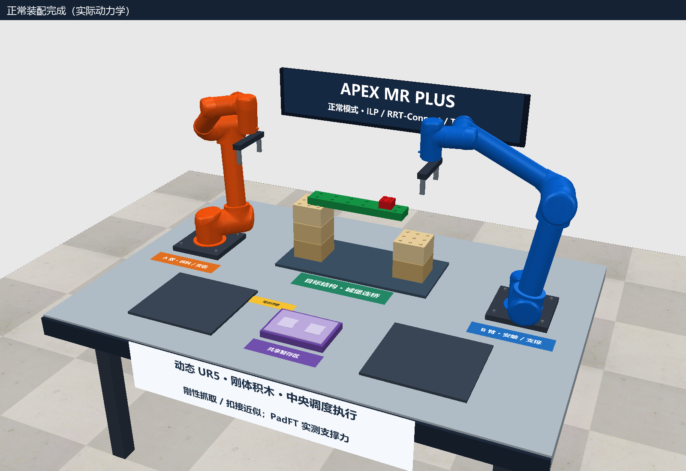
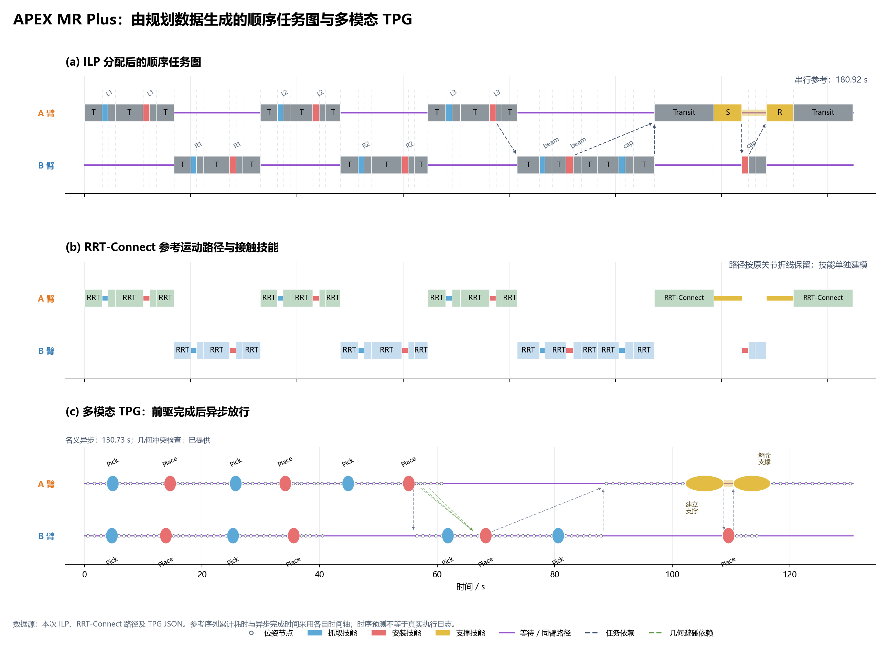

# APEX_MR_Plus：双臂积木装配与 TPG 调度

正常模式采用 **ILP 分工与抓取/支撑选择 → 顺序任务图 → RRT-Connect 参考路径 → 多模态 TPG → 中央调度器动力学执行**。详细模型、算法边界和输出说明见 [normal/README.md](normal/README.md)。

2026-10-28 的完整动力学执行已通过：7 块积木、53 条参考动作、165 个 TPG 节点全部完成，176 条依赖逐条核对通过。实际装配耗时 143.80 s，最大目标位置误差 1.60 mm，支撑反力峰值 13.84 N；所有连接力矩峰值低于 1.2 N·m。15 项测试通过。这是一次完整正常模式验收，不代表多次随机试验的成功率；原始结果见 `results/normal/summary.json`、`execution.json` 和 `execution_validation.json`。

## 正常模式入口

- **`Run_Normal_Mode.cmd`**：日常复跑，默认复用相符的 ILP/参考路径与 TPG，重新做名义几何检查并执行真实动力学。
- **`Replan_Normal_Mode.cmd`**：完整重算候选、ILP、RRT-Connect 路径和 TPG，再执行动力学。
- **`Open_APEX_MR_Plus.cmd`**：仅打开当前顶层主场景，不负责重新规划或生成验收结果。

两种运行入口都支持附加参数，如 `Run_Normal_Mode.cmd --no-video` 和 `Replan_Normal_Mode.cmd --plan-only`。只规划模式不会产生真实执行成功证据。

`scenes/10_Normal_Assembly.ttt` 是正常模式动态源场景；`scenes/11_Normal_APEX_MR_Planned.ttt` 保存已生成的计划和中央调度器。顶层 `APEX_MR_Plus.ttt` 已更新为该已规划场景：在 CoppeliaSim 中打开后点击 ▶，会从初始料盘布局开始，由嵌入的中央调度器执行整个装配。完成验收的命令行复跑也会自动更新该主场景。

## 模型与主要输出

正常任务包含七个可动物体 `L1、R1、L2、R2、L3、beam、cap`，采用放大模块尺寸。原生 UR5 的名义连杆质量和惯量、动态位置伺服、重力和刚体接触由 Bullet 求解。抓取和扣接使用动态理想刚性力传感器约束，不是实际 LEGO 摩擦夹持、卡扣弹性或插拔形变模型。装配顺序是给定输入；当前正常模式不包含能力退化后的自主恢复。

`results/normal/` 中包含分配输入/结果、RRT-Connect 关节路径、TPG 节点和依赖、相对相位碰撞采样证据、实际执行日志与相机录像。`normal_pipeline_tpg.png/.svg` 绘制顺序任务、参考运动和多模态 TPG；`normal_execution_timeline.png/.svg` 对照名义与实际时序。中断日志中的未完成任务有明确标记，不计作完成。

支撑候选要求鞋与梁底有至少 `2 mm` 的正投影接触重叠；执行时以 PadFT 稳定测得超过 `0.15 N` 的反力作为 8 N 插装加载的前置条件。支撑接近/撤离采用低速分段参考，允许不超过 `2 mm` 的虚拟 IK 高度参考补偿；连接矩连续 10 帧超过 `1.2 N·m` 时报告失败。桌面、底板和积木的名义摩擦系数设为 0.8，Pad 与原生 UR5 保留自身材料参数。

`execution_validation.json` 保存对真实执行日志的独立验收，`normal_dynamics_validation.png/.svg` 绘制动力学验收曲线，`delivery.json` 记录已验收主场景的 SHA-256。以上产物已由本次通过的完整运行生成；本次关闭录像，实际画面保存为 `completed_dynamic_scene.png` 和 `supporting_insertion.png`。

运行环境：CoppeliaSim Edu 4.10、Python 3.11，以及 `requirements.txt` 中的依赖。使用模拟器安装包自带、版本匹配的 ZeroMQ Python 客户端。所有算法和物理模型的适用范围见正常模式说明。

## 克隆后使用

安装 CoppeliaSim Edu 4.10 和 Python 3.11，在仓库目录执行 `python -m pip install -r requirements.txt`。默认模拟器目录为 `C:\Program Files\CoppeliaRobotics\CoppeliaSimEdu`；安装在其他目录时，将环境变量 `COPPELIASIM_ROOT` 设为实际安装位置。双击 `Open_APEX_MR_Plus.cmd` 打开场景，点击模拟器的 ▶ 执行已嵌入的计划；日常重新验收可运行 `Run_Normal_Mode.cmd --no-video`。仓库可以放在其他目录，文档中的 `D:\APEX_MR_Plus` 是原始开发路径。

仓库保留完整正常模式参考计划、TPG 和验收记录；运行日志、历史失败诊断、临时场景及 RRT 内部缓存仅留在本机，不纳入版本控制。部分 `probe_*`、`repair_*` 和冒烟脚本用于原始诊断过程，可能依赖这些本地历史；正常运行与重规划请使用上面的正式入口。

## 原有能力退化概念预览

原预览主场景保存在 **`backups/environment_preview/APEX_MR_Plus.ttt`**，可直接在 CoppeliaSim 中打开。场景内的中文控制面板切换以下预设状态；它们用于理解场景，不是恢复算法输出。

- **① 正常布局**：橙色 A 臂、蓝色 B 臂、左右料盘、共享暂存区、城堡连桥与黄色临时桥墩。
- **② A 臂能力变化**：A 持连接砖，B 在桥下处于支撑端点；A 的肘关节通过软件缩小允许运动范围，当前构型仍在该范围内。
- **③ 临时支撑到位**：桥墩已放在桥下，B 处于连接砖安装端点。此预设用于理解恢复后的布局。

三个预设也分别保存在 `scenes/01_Workcell_Overview.ttt`、`02_Capability_Change.ttt` 和 `03_Temporary_Support.ttt`。

## 概念预览范围

这部分是**运动学环境与 IK 端点预览**，切换预设直接设置物体和机械臂端点状态。预览中的场景结构采用静态设置，积木采用放大后的模块尺寸，非真实 LEGO 尺寸。它与上面的正常动力学基线分别保存。

尚未实现自主恢复搜索、碰撞自由的连接轨迹、真实 LEGO 卡扣连接、接触力控制和支撑承载动力学。预设③由场景作者指定，**不是算法生成的恢复结果**。关节范围缩小也未证明目标任务在该范围下整体不可行；这些内容需要后续规划与验证模块确认。

后续研究目标是从当前持物、连接和支撑状态出发，根据能力变化自动组合通用动作，并生成可执行的剩余计划。`config/experiment_definition.json` 记录动作接口与未来验证要求，不包含固定恢复动作链。

## 文件

- `APEX_MR_Plus.ttt`：顶层主场景，正常模式验收通过后更新为已规划的动态装配场景。
- `Run_Normal_Mode.cmd / Replan_Normal_Mode.cmd`：复用规划复跑 / 完整重算并执行。
- `Open_APEX_MR_Plus.cmd`：只打开当前顶层主场景。
- `normal/`：正常模式 ILP、运动规划、TPG、动力学中央调度与说明。
- `backups/environment_preview/APEX_MR_Plus.ttt`：原有静态概念预览，保留三种状态控制面板。
- `src/`：原预览场景构建、中文控制面板、纹理和打开工具。
- `assets/`：中文标牌 PNG 纹理。
- `scenes/`：原预览快照及正常模式动态源场景、已规划场景。
- `previews/`：从 CoppeliaSim 实际渲染得到的预览图。
- `config/scene_manifest.json`：生成后的几何、端点和场景元数据。
- `config/experiment_definition.json`：研究目标与未来算法接口。
- `results/normal/`：正常模式本次规划、几何验证、真实执行、录像与验收数据。
- `logs/ / results/coppeliasim-*.log`：工具与仿真器运行日志。
